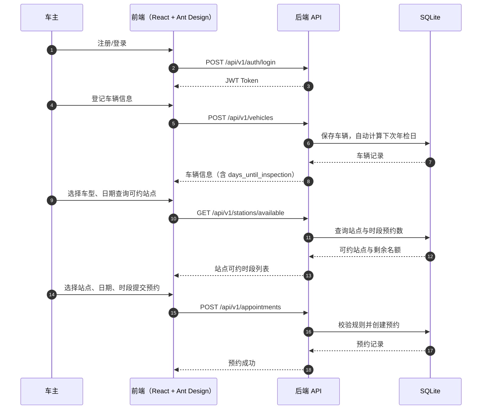
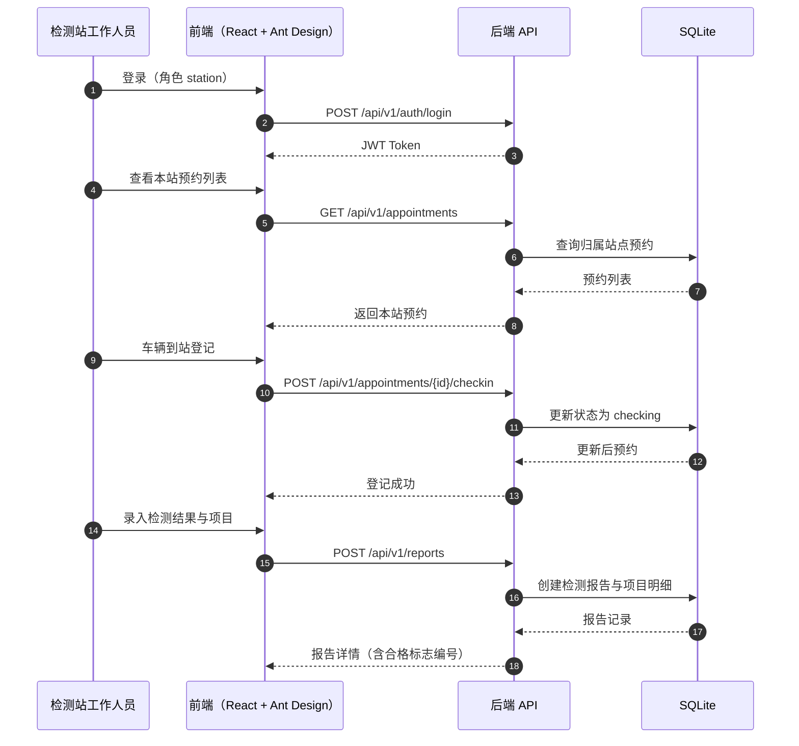
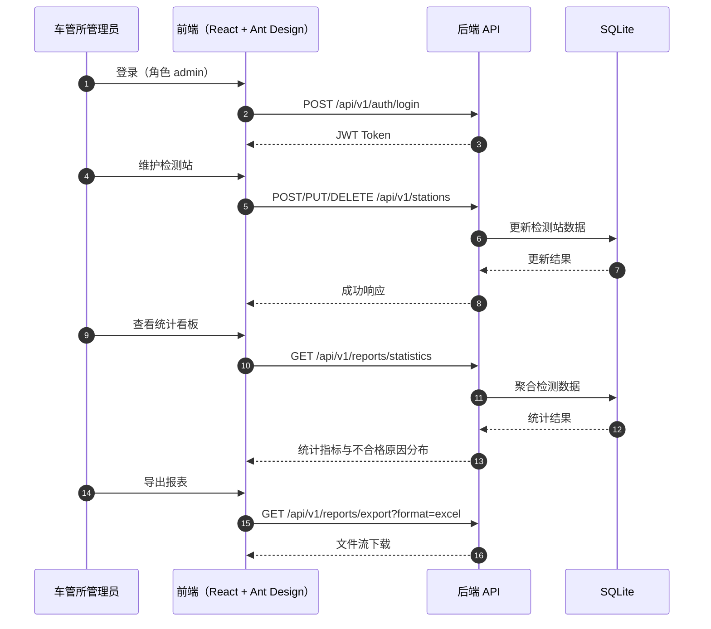

# 车辆年检预约管理系统产品需求文档（PRD）

## 1. 项目背景与目标

### 1.1 背景

传统车辆年检业务依赖车主到车管所或检测站现场排队办理，存在等待时间长、检测站资源利用率不均、监管数据滞后等问题。为提升年检服务效率，实现业务线上化、数据透明化，需要建设一套覆盖车主、检测站、车管所三方的车辆年检预约管理系统。

### 1.2 目标

- 为车主提供车辆登记、年检到期提醒、检测站在线预约、检测报告查询等一站式服务。
- 为检测站提供预约查询、车辆到站登记、检测结果录入、检测报告生成等工具。
- 为车管所提供检测站管理、年检统计看板、数据导出等监管能力。
- 通过角色权限控制，确保不同角色只能访问授权范围内的数据和功能。

## 2. 用户角色与权限

系统采用基于角色的访问控制（RBAC），当前实现三类角色：

| 角色 | 角色标识 | 权限范围 |
|------|----------|----------|
| 车主 | `owner` | 注册账号、登记本人车辆、查看车辆与年检提醒、预约检测、查询/取消本人预约、查看本人检测报告 |
| 检测站工作人员 | `station` | 由管理员分配归属检测站（`station_id`），可查看归属检测站的预约、办理到站登记、录入检测结果、查看归属站点的检测报告 |
| 车管所管理员 | `admin` | 管理系统用户、维护检测站、查看全部车辆/预约/报告、查看统计看板、导出 Excel/CSV |

**说明**：后端接口已实现上述角色的权限校验；前端已基于 React + Ant Design 实现按角色渲染的菜单与页面视图。

## 3. 功能需求

### 3.1 认证与账户模块

#### 3.1.1 用户注册

- **入口**：`/api/v1/auth/register`
- **角色**：未登录用户
- **输入**：用户名、密码、手机号（可选）、真实姓名（可选）
- **输出**：注册成功的用户信息（默认角色为 `owner`）
- **业务规则**：
  - 用户名全局唯一，重复返回 400。
  - 密码最少 8 位，不满足返回 422。
  - 注册接口仅面向车主公开注册；检测站工作人员与管理员需由管理员通过用户管理接口创建。

#### 3.1.2 用户登录

- **入口**：`/api/v1/auth/login`
- **角色**：所有用户
- **输入**：用户名、密码（OAuth2 表单）
- **输出**：JWT Access Token（Bearer），有效期 24 小时
- **业务规则**：
  - 用户名或密码错误返回 401。
  - Token 用于后续接口鉴权。

#### 3.1.3 获取当前用户

- **入口**：`/api/v1/auth/me`
- **角色**：已登录用户
- **输出**：当前登录用户信息（含角色、归属检测站等）

#### 3.1.4 修改密码

- **入口**：`/api/v1/auth/password`（PUT）
- **角色**：所有已登录用户
- **输入**：旧密码、新密码（最少 8 位）
- **业务规则**：
  - 旧密码校验失败返回 400。
  - 修改成功后可使用新密码重新登录。

### 3.2 用户管理模块

- **入口**：`/api/v1/users/*`
- **角色**：仅 `admin`
- **功能**：
  - 创建用户（可指定角色为 `owner`/`station`/`admin`、归属检测站）。
  - 查询用户列表（支持分页）。
  - 查询单个用户详情。
- **业务规则**：
  - 创建用户时用户名不可重复。
  - 密码最少 8 位。
  - 角色为 `station` 时必须指定 `station_id`，缺失返回 422。

### 3.3 检测站管理模块

- **入口**：`/api/v1/stations/*`
- **写操作角色**：仅 `admin`
- **读操作角色**：所有已登录用户
- **功能**：
  - 新增检测站：名称、地址、联系方式、可检车型、日检测能力。
  - 修改检测站信息。
  - 删除检测站。
  - 查询检测站列表与详情。
  - 查询指定车型在某日期的可约检测站及剩余时段名额：`/api/v1/stations/available`。
- **字段说明**：
  - `allowed_vehicle_types`：逗号分隔的车型字符串（如 `small_car,truck`），预约时按车型做不区分大小写匹配。
  - `daily_capacity`：检测站每日总检测能力，用于计算各时段剩余名额。
- **可约时段**：固定为 `08:00-10:00`、`10:00-12:00`、`13:00-15:00`、`15:00-17:00` 四个时段。
- **时段容量**：`max(1, daily_capacity // 4)`。
- **删除保护**：存在关联预约或归属员工时禁止删除，返回 409。

### 3.4 车辆管理模块

- **入口**：`/api/v1/vehicles/*`
- **角色**：
  - `owner`：仅可操作本人车辆。
  - `admin`/`station`：可查看全部车辆，创建车辆时自动关联当前登录用户。
- **功能**：
  - 登记车辆：车牌号、车型、注册日期、使用性质、下次年检日期。
  - 查询车辆列表/详情。
  - 修改车辆信息。
  - 删除车辆。
- **业务规则**：
  - 车牌号全局唯一，重复返回 400。
  - 若未填写 `next_inspection_date`，系统根据 `register_date` 自动计算：从注册日期起按周年递增，返回最近一个大于等于今天的周年日（已处理闰年 2 月 29 日转入非闰年的边界）。
  - `days_until_inspection` 计算字段返回距离下次年检剩余天数（可为负数，表示已过期）。
  - **删除保护**：存在关联预约时禁止删除，返回 409。

### 3.5 年检到期提醒模块

- **触发条件**：系统根据车辆 `next_inspection_date` 计算剩余天数。
- **提醒规则**：距离年检到期日 ≤ 60 天的车辆视为需要提醒（前端可在车主首页展示）。
- **数据来源**：车辆接口返回的 `days_until_inspection` 字段。

### 3.6 在线预约模块

- **入口**：`/api/v1/appointments/*`
- **创建预约角色**：所有已登录用户（车主为自己车辆预约，管理员/检测站可代为预约）
- **功能**：
  - 创建预约：选择车辆、检测站、预约日期、时段。
  - 查询预约列表/详情。
  - 修改预约（仅限日期、时段），`owner` 不可修改；不允许通过修改接口直接变更检测站或状态。
  - 取消预约：`/api/v1/appointments/{id}/cancel`。
  - 到站登记：`/api/v1/appointments/{id}/checkin`（仅 `station`/`admin`）。
- **预约状态**：
  - `booked`：已预约
  - `checking`：检测中（到站登记后）
  - `completed`：已完成（录入检测报告后系统自动更新）
  - `cancelled`：已取消
- **预约规则校验**：
  1. 预约日期不能早于今天。
  2. 预约日期不能超过未来 30 天。
  3. 同一车辆同一时间只能存在一个有效预约（状态为 `booked` 或 `checking`）。
  4. 所选检测站必须支持当前车辆车型（按 `allowed_vehicle_types` 不区分大小写匹配）。
  5. 所选日期与时段剩余名额必须 > 0（名额校验与预约创建在临界区锁内原子执行，防止并发超卖）。
- **权限规则**：
  - `owner` 只能查看/取消本人车辆的预约。
  - `station` 只能查看/操作归属检测站的预约。
  - 取消预约：仅管理员或预约车辆的车主可操作；仅 `booked`/`checking` 状态可取消。
  - 到站登记：仅 `station`/`admin` 可操作；仅 `booked` 状态可登记；检测站工作人员只能登记归属检测站的预约。
  - 删除预约：仅 `admin` 可操作；已生成检测报告的预约禁止删除，返回 409（`owner` 应使用取消接口保留数据）。

### 3.7 年检登记与检测模块

- **入口**：`/api/v1/reports/*`
- **创建报告角色**：`station`/`admin`
- **功能**：
  - 录入检测报告：关联预约、填写总体结果、备注、检测项目明细。
  - 查询检测报告列表/详情。
- **检测结果**：
  - `pass`：合格
  - `fail`：不合格
  - `retest`：复检
- **检测项目结果**：同总体结果枚举 `pass`/`fail`/`retest`。
- **业务规则**：
  - 一个预约只能对应一份检测报告。
  - 预约必须处于 `checking`（已到站登记）状态方可录入检测结果，否则返回 400。
  - 检测站工作人员只能为归属检测站的预约创建报告。
  - 报告创建成功后，预约状态自动更新为 `completed`。
  - 报告创建后，系统为合格车辆自动生成电子合格标志编号 `sticker_code`。

### 3.8 检测报告与电子合格标志模块

- **电子合格标志编号规则**：
  - 仅当报告结果为 `pass` 时生成。
  - 格式：`VIC-{YYYYMMDD}-{report_id}-{plate_number}`。
- **查看报告**：车主、检测站、管理员可在授权范围内查看报告详情，包含总体结果、检测项目、备注、合格标志编号。

### 3.9 年检统计看板模块

- **入口**：`/api/v1/reports/statistics`
- **角色**：仅 `admin`
- **输入**：开始日期、结束日期、检测站 ID（可选）
- **输出**：
  - 检测总量
  - 合格数/不合格数/复检数
  - 合格率
  - 不合格原因分布（按检测项目名称聚合）
- **业务规则**：
  - 结束日期不可早于开始日期。
  - 可按单检测站筛选，也可跨站统计。

### 3.10 数据导出模块

- **入口**：`/api/v1/reports/export`
- **角色**：仅 `admin`
- **输入**：格式（`excel`/`csv`）、开始日期、结束日期、检测站 ID（可选）
- **输出**：下载 `reports.xlsx` 或 `reports.csv`
- **导出字段**：车牌、检测站、预约日期、检测结果、检测项目、备注。

## 4. 核心业务流程

### 4.1 车主预约流程

### 4.2 检测站检测流程

### 4.3 车管所监管流程

## 5. 用户场景与用例

### 5.1 车主场景

| 用例编号 | 用例名称 | 参与者 | 前置条件 | 主要步骤 | 预期结果 |
|----------|----------|--------|----------|----------|----------|
| UC-001 | 车主注册 | 车主 | 无 | 填写用户名、密码等 → 提交注册 | 注册成功，角色为 owner |
| UC-002 | 车主登录 | 车主 | 已注册 | 输入用户名密码 → 登录 | 返回 JWT Token |
| UC-003 | 登记车辆 | 车主 | 已登录 | 填写车牌、车型、注册日期等 → 提交 | 车辆保存，自动计算下次年检日 |
| UC-004 | 查看年检提醒 | 车主 | 已登记车辆 | 进入首页/车辆列表 | 看到 60 天内到期车辆提醒 |
| UC-005 | 预约检测 | 车主 | 车辆已登记 | 查询可约站点 → 选择时段 → 提交预约 | 生成已预约状态预约单 |
| UC-006 | 取消预约 | 车主 | 存在可取消预约 | 选择预约 → 取消 | 预约状态变为 cancelled |
| UC-007 | 查看检测报告 | 车主 | 检测已完成 | 进入报告列表/详情 | 看到结果、项目、合格标志 |

### 5.2 检测站场景

| 用例编号 | 用例名称 | 参与者 | 前置条件 | 主要步骤 | 预期结果 |
|----------|----------|--------|----------|----------|----------|
| UC-008 | 检测站工作人员登录 | 检测站工作人员 | 管理员已创建账号 | 输入用户名密码 → 登录 | 返回 JWT Token |
| UC-009 | 查看本站预约 | 检测站工作人员 | 已登录 | 进入预约列表 | 仅看到归属站点预约 |
| UC-010 | 车辆到站登记 | 检测站工作人员 | 存在本站 booked 预约 | 选择预约 → 登记到站 | 状态变为 checking |
| UC-011 | 录入检测结果 | 检测站工作人员 | 预约状态为 checking | 填写结果、项目、备注 → 提交 | 生成检测报告与合格标志 |

### 5.3 车管所场景

| 用例编号 | 用例名称 | 参与者 | 前置条件 | 主要步骤 | 预期结果 |
|----------|----------|--------|----------|----------|----------|
| UC-012 | 管理员登录 | 车管所管理员 | 默认账号已初始化 | 输入 admin/admin123 → 登录 | 返回 JWT Token |
| UC-013 | 维护检测站 | 车管所管理员 | 已登录 | 新增/编辑/删除检测站 | 检测站数据更新 |
| UC-014 | 创建用户 | 车管所管理员 | 已登录 | 填写用户名、密码、角色、归属站点 | 用户创建成功 |
| UC-015 | 查看统计看板 | 车管所管理员 | 已登录 | 选择日期范围/站点 → 查询 | 返回统计指标 |
| UC-016 | 导出报表 | 车管所管理员 | 已登录 | 选择格式、日期、站点 → 导出 | 下载 Excel/CSV |

## 6. 非功能需求

### 6.1 性能需求

- API 响应时间：常规查询接口在单表百万级以下数据量时 P95 响应时间 < 500ms。
- 并发支持：基于 SQLite 的当前实现适合中小规模并发；如需高并发可迁移至 PostgreSQL/MySQL。
- 导出文件大小：当前实现为同步生成并流式返回，建议单次导出时间跨度不超过一年。

### 6.2 安全需求

- 密码使用 bcrypt 算法加密存储，禁止明文保存或传输。
- 接口使用 JWT（HS256）鉴权，Token 有效期 24 小时，通过 Bearer 头部传递。
- 接口级 RBAC 控制：未登录返回 401，越权访问返回 403。
- CORS 已开启并允许所有来源（开发环境配置），生产环境应收紧为前端域名。
- 默认管理员账号密码在初始化脚本中生成，生产环境必须强制修改。

### 6.3 易用性需求

- 提供 OpenAPI/Swagger 文档（`/docs`）与 ReDoc（`/redoc`），便于前后端联调与测试。
- 错误信息统一返回 HTTP 状态码 + `detail` 文本，前端可据此展示友好提示。
- 关键业务规则在服务端做最终校验，避免仅依赖前端校验带来的数据风险。

### 6.4 可维护性需求

- 后端采用 FastAPI 路由分模块组织（auth/users/stations/vehicles/appointments/reports）。
- 数据模型与 Pydantic Schema 分离，便于后续扩展与校验规则调整。
- 数据库使用 SQLAlchemy ORM，便于后续切换其他关系型数据库。
