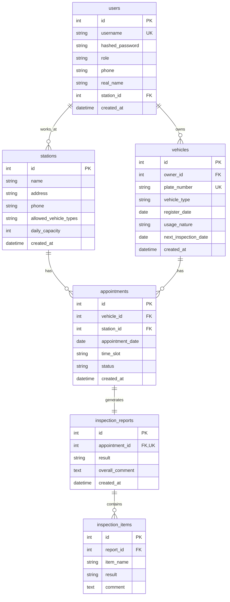

# 车辆年检预约管理系统技术方案文档

## 1. 系统架构

### 1.1 整体架构

系统目标为前后端分离架构：

- **前端**：React + Vite + Ant Design，已位于 `frontend/` 目录并实现各角色页面。
- **后端**：Python FastAPI + SQLAlchemy + SQLite，已位于 `backend/` 目录。
- **通信**：RESTful API，JSON 数据格式。

```mermaid
graph TB
    subgraph 客户端层
        A[Web 浏览器]
    end

    subgraph 前端层（React + Vite + Ant Design）
        B[React + Vite + Ant Design]
    end

    subgraph 后端层（已实现）
        C[FastAPI 应用]
        D[JWT 鉴权 / RBAC]
        E[业务路由层]
        F[CRUD 层]
        G[SQLAlchemy ORM]
    end

    subgraph 数据层（已实现）
        H[SQLite 文件数据库]
    end

    A --> B
    B -->|HTTP REST /api/v1/*| C
    C --> D
    D --> E
    E --> F
    F --> G
    G --> H
```

### 1.2 后端模块结构

```
backend/
├── app/
│   ├── main.py              # FastAPI 应用入口、CORS、路由注册
│   ├── database.py          # SQLAlchemy 引擎、会话、Base
│   ├── models.py            # 数据库模型
│   ├── schemas.py           # Pydantic 请求/响应模型
│   ├── crud.py              # 数据库 CRUD 操作
│   ├── auth.py              # 密码加密、JWT 签发/校验、RBAC 依赖
│   └── routers/
│       ├── auth.py          # 登录/注册/当前用户
│       ├── users.py         # 用户管理（admin）
│       ├── stations.py      # 检测站管理 + 可约时段查询
│       ├── vehicles.py      # 车辆管理
│       ├── appointments.py  # 预约管理 + 到站登记
│       └── reports.py       # 检测报告 + 统计 + 导出
├── init_db.py               # 数据库初始化与默认管理员
├── requirements.txt         # Python 依赖
└── vehicle_inspection.db    # SQLite 数据库文件（运行时生成）
```

## 2. 技术选型与版本

| 层级 | 技术 | 版本 | 说明 |
|------|------|------|------|
| 后端框架 | FastAPI | 0.115.0 | 异步 Web 框架，自动生成 OpenAPI 文档 |
| 服务器 | Uvicorn | 0.30.6 | ASGI 服务器，支持热重载 |
| ORM | SQLAlchemy | 2.0.35 | 数据库模型与查询 |
| 数据校验 | Pydantic | 2.9.2 | 请求/响应模型校验 |
| 配置 | pydantic-settings | 2.5.2 | 环境变量配置（预留） |
| 鉴权 | python-jose[cryptography] | 3.3.0 | JWT 签发与校验 |
| 密码加密 | passlib[bcrypt] / bcrypt | 1.7.4 / 4.2.1 | bcrypt 哈希 |
| 文件上传 | python-multipart | 0.0.10 | OAuth2 表单登录所需 |
| Excel 导出 | openpyxl | 3.1.5 | 生成 .xlsx 文件 |
| 数据库 | SQLite | 内置 | 文件型关系数据库 |
| 测试 | pytest / httpx | 8.3.3 / 0.27.2 | 单元/集成测试 |
| 前端 | React + Vite + Ant Design | react ^19.2.8 / vite ^4.5.13 / antd ^6.6.2 | 已实现于 frontend/ 目录 |

## 3. 数据库设计

### 3.1 ER 图



### 3.2 表结构说明

#### 3.2.1 `users`（用户表）

| 字段 | 类型 | 约束 | 说明 |
|------|------|------|------|
| id | INTEGER | PK, AUTOINCREMENT | 用户 ID |
| username | VARCHAR | UNIQUE, NOT NULL | 用户名 |
| hashed_password | VARCHAR | NOT NULL | bcrypt 加密后的密码 |
| role | VARCHAR | NOT NULL, DEFAULT 'owner' | 角色：owner/station/admin |
| phone | VARCHAR | NULL | 手机号 |
| real_name | VARCHAR | NULL | 真实姓名 |
| station_id | INTEGER | FK → stations.id, NULL | 检测站工作人员归属站点 |
| created_at | DATETIME | NOT NULL, DEFAULT CURRENT_TIMESTAMP | 创建时间 |

#### 3.2.2 `stations`（检测站表）

| 字段 | 类型 | 约束 | 说明 |
|------|------|------|------|
| id | INTEGER | PK, AUTOINCREMENT | 检测站 ID |
| name | VARCHAR | NOT NULL | 检测站名称 |
| address | VARCHAR | NULL | 地址 |
| phone | VARCHAR | NULL | 联系电话 |
| allowed_vehicle_types | VARCHAR | NULL | 可检车型，逗号分隔 |
| daily_capacity | INTEGER | NOT NULL, DEFAULT 50 | 日检测能力 |
| created_at | DATETIME | NOT NULL, DEFAULT CURRENT_TIMESTAMP | 创建时间 |

#### 3.2.3 `vehicles`（车辆表）

| 字段 | 类型 | 约束 | 说明 |
|------|------|------|------|
| id | INTEGER | PK, AUTOINCREMENT | 车辆 ID |
| owner_id | INTEGER | FK → users.id, NOT NULL | 车主用户 ID |
| plate_number | VARCHAR | UNIQUE, NOT NULL | 车牌号 |
| vehicle_type | VARCHAR | NOT NULL | 车型 |
| register_date | DATE | NULL | 注册日期 |
| usage_nature | VARCHAR | NULL, DEFAULT 'non_operational' | 使用性质 |
| next_inspection_date | DATE | NULL | 下次年检到期日 |
| created_at | DATETIME | NOT NULL, DEFAULT CURRENT_TIMESTAMP | 创建时间 |

#### 3.2.4 `appointments`（预约表）

| 字段 | 类型 | 约束 | 说明 |
|------|------|------|------|
| id | INTEGER | PK, AUTOINCREMENT | 预约 ID |
| vehicle_id | INTEGER | FK → vehicles.id, NOT NULL | 车辆 ID |
| station_id | INTEGER | FK → stations.id, NOT NULL | 检测站 ID |
| appointment_date | DATE | NOT NULL | 预约日期 |
| time_slot | VARCHAR | NOT NULL | 预约时段 |
| status | VARCHAR | NOT NULL, DEFAULT 'booked' | booked/checking/completed/cancelled |
| created_at | DATETIME | NOT NULL, DEFAULT CURRENT_TIMESTAMP | 创建时间 |

#### 3.2.5 `inspection_reports`（检测报告表）

| 字段 | 类型 | 约束 | 说明 |
|------|------|------|------|
| id | INTEGER | PK, AUTOINCREMENT | 报告 ID |
| appointment_id | INTEGER | FK → appointments.id, UNIQUE, NOT NULL | 关联预约 |
| result | VARCHAR | NOT NULL | pass/fail/retest |
| overall_comment | TEXT | NULL | 总体备注 |
| created_at | DATETIME | NOT NULL, DEFAULT CURRENT_TIMESTAMP | 创建时间 |

#### 3.2.6 `inspection_items`（检测项目表）

| 字段 | 类型 | 约束 | 说明 |
|------|------|------|------|
| id | INTEGER | PK, AUTOINCREMENT | 项目 ID |
| report_id | INTEGER | FK → inspection_reports.id, NOT NULL | 关联报告 |
| item_name | VARCHAR | NOT NULL | 检测项目名称 |
| result | VARCHAR | NOT NULL | pass/fail/retest |
| comment | TEXT | NULL | 项目备注 |

### 3.3 关系说明

- `users.station_id` → `stations.id`：一个检测站可有多名工作人员（`User.station` ↔ `Station.staff`）。
- `vehicles.owner_id` → `users.id`：一个车主可拥有多辆车（`User.vehicles` ↔ `Vehicle.owner`）。
- `appointments.vehicle_id` → `vehicles.id`：一辆车可有多条历史预约（`Vehicle.appointments` ↔ `Appointment.vehicle`）。
- `appointments.station_id` → `stations.id`：一个检测站可有多条预约（`Station.appointments` ↔ `Appointment.station`）。
- `inspection_reports.appointment_id` → `appointments.id`：一个预约对应一份报告（`Appointment.inspection_report` ↔ `InspectionReport.appointment`）。
- `inspection_items.report_id` → `inspection_reports.id`：一份报告可包含多个检测项目（`InspectionReport.items` ↔ `InspectionItem.report`）。

## 4. 接口设计

### 4.1 接口总览

| 模块 | 基础路径 | 说明 |
|------|----------|------|
| 认证 | `/api/v1/auth` | 登录、注册、当前用户、修改密码 |
| 用户 | `/api/v1/users` | 用户 CRUD（admin） |
| 检测站 | `/api/v1/stations` | 检测站管理与可约查询 |
| 车辆 | `/api/v1/vehicles` | 车辆登记与管理 |
| 预约 | `/api/v1/appointments` | 预约与到站登记 |
| 报告 | `/api/v1/reports` | 检测报告、统计、导出 |

### 4.2 认证接口

#### POST /api/v1/auth/login

- **功能**：用户登录
- **请求头**：`Content-Type: application/x-www-form-urlencoded`
- **请求参数**：
  - `username`（string，必填）
  - `password`（string，必填）
- **成功响应**：
  ```json
  {
    "access_token": "eyJhbGciOiJIUzI1NiIs...",
    "token_type": "bearer"
  }
  ```
- **失败响应**：401 `{"detail": "Incorrect username or password"}`

#### POST /api/v1/auth/register

- **功能**：车主公开注册
- **请求体**：
  ```json
  {
    "username": "owner01",
    "password": "pass1234",
    "phone": "13800138000",
    "real_name": "张三"
  }
  ```
- **成功响应**：201，返回 `UserResponse`（默认角色 owner）
- **失败响应**：400 用户名已存在

#### GET /api/v1/auth/me

- **功能**：获取当前登录用户信息
- **请求头**：`Authorization: Bearer <token>`
- **成功响应**：`UserResponse`

#### PUT /api/v1/auth/password

- **功能**：修改当前用户密码
- **请求头**：`Authorization: Bearer <token>`
- **请求体**：
  ```json
  {
    "old_password": "旧密码",
    "new_password": "新密码（最少 8 位）"
  }
  ```
- **成功响应**：200，返回 `UserResponse`
- **失败响应**：
  - 400 旧密码错误
  - 422 新密码不足 8 位

### 4.3 用户管理接口（admin）

#### POST /api/v1/users/

- **功能**：创建用户（可指定角色与归属检测站）
- **请求体**：`UserCreate`
  ```json
  {
    "username": "station01",
    "password": "pass1234",
    "role": "station",
    "phone": "13900139000",
    "real_name": "检测员李",
    "station_id": 1
  }
  ```
- **校验规则**：
  - 密码最少 8 位（`min_length=8`），不满足返回 422。
  - `role` 为 `station` 时必须提供 `station_id`，否则返回 422。
- **成功响应**：201 `UserResponse`

#### GET /api/v1/users/

- **功能**：用户列表
- **查询参数**：`skip`、`limit`
- **成功响应**：`List[UserResponse]`

#### GET /api/v1/users/{user_id}

- **功能**：用户详情
- **成功响应**：`UserResponse`

### 4.4 检测站接口

#### POST /api/v1/stations/

- **功能**：新增检测站（admin）
- **请求体**：`StationCreate`
  ```json
  {
    "name": "城北检测站",
    "address": "城北大道 1 号",
    "phone": "010-12345678",
    "allowed_vehicle_types": "small_car,truck",
    "daily_capacity": 80
  }
  ```
- **成功响应**：201 `StationResponse`

#### GET /api/v1/stations/

- **功能**：检测站列表
- **查询参数**：`skip`、`limit`
- **成功响应**：`List[StationResponse]`

#### GET /api/v1/stations/available

- **功能**：查询指定车型在某日期的可约检测站及剩余名额
- **查询参数**：
  - `vehicle_type`（string，必填）
  - `date`（date，必填，YYYY-MM-DD）
- **成功响应**：
  ```json
  [
    {
      "station": { "id": 1, "name": "城北检测站", ... },
      "time_slots": [
        { "time_slot": "08:00-10:00", "remaining": 10 },
        { "time_slot": "10:00-12:00", "remaining": 12 },
        ...
      ]
    }
  ]
  ```

#### GET /api/v1/stations/{station_id}

- **功能**：检测站详情

#### PUT /api/v1/stations/{station_id}

- **功能**：修改检测站信息（admin）
- **请求体**：`StationUpdate`

#### DELETE /api/v1/stations/{station_id}

- **功能**：删除检测站（admin）
- **成功响应**：204
- **失败响应**：409 存在关联预约或归属员工时禁止删除

### 4.5 车辆接口

#### POST /api/v1/vehicles/

- **功能**：登记车辆
- **请求体**：`VehicleCreate`
  ```json
  {
    "plate_number": "京A12345",
    "vehicle_type": "small_car",
    "register_date": "2020-01-15",
    "usage_nature": "non_operational"
  }
  ```
- **业务规则**：未传 `next_inspection_date` 时自动根据注册日期计算。
- **成功响应**：201 `VehicleResponse`（含 `days_until_inspection`）

#### GET /api/v1/vehicles/

- **功能**：车辆列表
- **权限**：owner 仅见本人车辆；admin/station 见全部车辆。

#### GET /api/v1/vehicles/{vehicle_id}

- **功能**：车辆详情
- **权限**：owner 只能查看本人车辆。

#### PUT /api/v1/vehicles/{vehicle_id}

- **功能**：修改车辆信息
- **请求体**：`VehicleUpdate`

#### DELETE /api/v1/vehicles/{vehicle_id}

- **功能**：删除车辆
- **成功响应**：204
- **失败响应**：409 存在关联预约时禁止删除

### 4.6 预约接口

#### POST /api/v1/appointments/

- **功能**：创建预约
- **请求体**：`AppointmentCreate`
  ```json
  {
    "vehicle_id": 1,
    "station_id": 1,
    "appointment_date": "2026-09-10",
    "time_slot": "08:00-10:00"
  }
  ```
- **校验规则**：日期不早于今天、不超过 30 天、车辆无有效预约、站点支持车型、时段有名额。
- **并发控制**：名额校验与预约创建在同一进程内临界区锁（`threading.Lock`）中执行，防止并发请求超卖时段名额。
- **成功响应**：201 `AppointmentResponse`（含嵌套 `vehicle`、`station` 摘要信息）

#### GET /api/v1/appointments/

- **功能**：预约列表
- **权限**：owner 仅见本人车辆预约；station 仅见归属站点预约；admin 见全部。

#### GET /api/v1/appointments/{appointment_id}

- **功能**：预约详情

#### PUT /api/v1/appointments/{appointment_id}

- **功能**：修改预约信息（owner 不可调用）
- **请求体**：`AppointmentUpdate`

#### POST /api/v1/appointments/{appointment_id}/cancel

- **功能**：取消预约
- **权限**：admin 或预约车辆车主。
- **业务规则**：仅 `booked`/`checking` 可取消。

#### POST /api/v1/appointments/{appointment_id}/checkin

- **功能**：车辆到站登记
- **权限**：station/admin；station 仅可操作归属站点预约。
- **业务规则**：仅 `booked` 状态可登记，登记后状态变为 `checking`。

#### DELETE /api/v1/appointments/{appointment_id}

- **功能**：删除预约
- **权限**：仅 `admin`（owner 请使用取消接口，软性取消数据仍保留）。
- **成功响应**：204
- **失败响应**：409 预约已生成检测报告时禁止删除

### 4.7 检测报告接口

#### POST /api/v1/reports/

- **功能**：创建检测报告
- **权限**：station/admin
- **请求体**：`InspectionReportCreate`
  ```json
  {
    "appointment_id": 1,
    "result": "pass",
    "overall_comment": "全部合格",
    "items": [
      { "item_name": "尾气检测", "result": "pass", "comment": "" },
      { "item_name": "制动检测", "result": "pass", "comment": "" }
    ]
  }
  ```
- **状态前置校验**：预约必须处于 `checking`（已到站登记）状态方可录入结果，否则返回 400。
- **状态流转**：报告创建成功后预约状态自动更新为 `completed`。
- **成功响应**：201 `InspectionReportResponse`（合格时含 `sticker_code`，含嵌套 `appointment` 信息）

#### GET /api/v1/reports/

- **功能**：检测报告列表
- **权限**：按角色过滤数据范围。

#### GET /api/v1/reports/{report_id}

- **功能**：检测报告详情

#### GET /api/v1/reports/statistics

- **功能**：年检统计
- **查询参数**：
  - `start_date`（必填）
  - `end_date`（必填）
  - `station_id`（可选）
- **成功响应**：
  ```json
  {
    "total_count": 100,
    "pass_count": 85,
    "fail_count": 10,
    "retest_count": 5,
    "pass_rate": 85.0,
    "fail_reasons": {
      "尾气检测": 6,
      "制动检测": 4
    }
  }
  ```

#### GET /api/v1/reports/export

- **功能**：导出检测报告
- **查询参数**：
  - `format`（必填）：`excel` 或 `csv`
  - `start_date`（必填）
  - `end_date`（必填）
  - `station_id`（可选）
- **成功响应**：文件流下载 `reports.xlsx` 或 `reports.csv`

## 5. 安全设计

### 5.1 密码加密

- 采用 `passlib` 的 `CryptContext` 使用 `bcrypt` 算法对用户密码进行哈希。
- 数据库仅存储 `hashed_password`，不保存明文。
- 登录时通过 `pwd_context.verify()` 校验密码。

### 5.2 JWT 鉴权

- 算法：`HS256`
- 密钥：优先读取环境变量 `SECRET_KEY`；未设置时自动生成临时随机密钥并输出告警日志（重启后所有 Token 失效），生产环境必须显式设置。
- Token 有效期：24 小时（`ACCESS_TOKEN_EXPIRE_MINUTES = 60 * 24`）。
- Token 载体：`{"sub": "用户名", "exp": "过期时间"}`。
- 保护方式：依赖 `auth.get_current_user` 从请求头 `Authorization: Bearer <token>` 中解析并验证用户。

### 5.3 RBAC 权限控制

- 角色枚举：`owner`/`station`/`admin`。
- `auth.require_role(*roles)` 依赖用于限制接口可访问角色。
- 数据范围控制：
  - `owner`：只能查看本人车辆、预约、报告。
  - `station`：只能查看归属检测站的预约、报告。
  - `admin`：可查看全部数据，拥有写权限。
- 越权访问返回 HTTP 403，未登录或 Token 无效返回 HTTP 401。

### 5.4 其他安全说明

- CORS 采用环境变量 `CORS_ORIGINS` 配置的白名单机制（默认 `http://localhost:5173,http://127.0.0.1:5173`），且 `allow_credentials=False`；生产环境通过该环境变量收紧为实际前端域名。
- 默认管理员账号 `admin/admin123` 通过 `init_db.py` 初始化，初始化时会输出弱口令告警日志，生产环境必须立即修改密码或关闭默认账号。
- 所有用户密码强度约束：注册与创建用户时密码最少 8 位（Pydantic `min_length=8`）；支持登录用户通过 `PUT /api/v1/auth/password` 自助修改密码。

## 6. 部署与运行说明

### 6.1 环境要求

- Python 3.10+
- 已创建并激活虚拟环境（推荐）

### 6.2 安装依赖

```powershell
python -m venv venv
.\venv\Scripts\activate
pip install -r backend\requirements.txt
```

### 6.3 初始化数据库

```powershell
.\venv\Scripts\python.exe backend\init_db.py
```

初始化脚本会：
- 创建所有数据表。
- 插入默认管理员账号：
  - 用户名：`admin`
  - 密码：`admin123`
  - 角色：`admin`

### 6.4 启动后端服务

从项目根目录启动：

```powershell
.\venv\Scripts\uvicorn.exe backend.app.main:app --reload
```

或进入 backend 目录：

```powershell
cd backend
..\venv\Scripts\uvicorn.exe app.main:app --reload
```

服务默认运行在 `http://127.0.0.1:8000`。

### 6.5 查看 API 文档

- Swagger UI：`http://127.0.0.1:8000/docs`
- ReDoc：`http://127.0.0.1:8000/redoc`
- 健康检查：`GET http://127.0.0.1:8000/health`

### 6.6 前端说明

前端工程已位于 `frontend/` 目录，使用 React + Vite + Ant Design 实现。

启动方式：

```powershell
cd frontend
npm install
npm run dev
```

前端开发服务器默认运行在 `http://127.0.0.1:5173`，通过后端已开启的 CORS 访问 `http://127.0.0.1:8000`。

生产构建：

```powershell
cd frontend
npm run build
```

构建产物位于 `frontend/dist/`。

### 6.7 运行测试

```powershell
.\venv\Scripts\pytest.exe backend
```

## 7. 关键设计补充说明

### 7.1 下次年检日期计算

```python
def calculate_next_inspection_date(register_date: date) -> date:
    today = date.today()
    candidate = register_date
    while candidate < today:
        try:
            candidate = candidate.replace(year=candidate.year + 1)
        except ValueError:
            candidate = date(candidate.year + 1, 3, 1)
    return candidate
```

从注册日期起按周年逐年递增，返回最近一个大于等于今天的周年日；对闰年 2 月 29 日转入非闰年的情况做了边界处理。

### 7.2 可约时段与容量

- 固定时段：`08:00-10:00`、`10:00-12:00`、`13:00-15:00`、`15:00-17:00`。
- 单时段容量 = `max(1, daily_capacity // len(TIME_SLOTS))`。
- 剩余名额 = 单时段容量 - 该时段已预约数（排除 `cancelled` 状态）。
